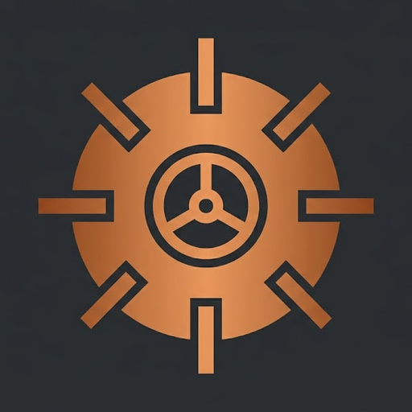

# Crypton 🛡️

<p align="center">
  
</p>

<p align="center">
  <strong>The Portable Encrypted USB Vault &amp; Zero-Knowledge Cloud Backup App</strong>
</p>

<p align="center">
  
  
  
  
  
</p>

---

## 🌟 What is Crypton?

**Crypton** is an easy-to-use, zero-friction encrypted vault application designed to run directly from any generic USB thumb drive.

Simply plug your pendrive into any PC (Windows or Linux), launch Crypton, enter your master password, and your vault unlocks instantly:
- On **Windows**, it mounts as a virtual drive letter (**`Z:\`**).
- On **Linux**, it mounts as a clean, transparent folder (**`Vault_Unlocked`**).

Drag, drop, open, view, or edit documents, photos, and files just like a regular folder. Behind the scenes, Crypton encrypts and decrypts everything on the fly using military-grade **AES-256-GCM**. When you click **Lock & Safely Close**, your files are sealed with zero trace left on the host computer.

---

## ✨ Highlights

- 🚀 **100% Portable — Zero Admin Rights Needed:** Runs out-of-the-box on guest computers, university labs, or office workstations without installing kernel drivers or requesting administrator privileges.
- 🌿 **Fresh, Modern Glassmorphic UI:** Features an eye-pleasing, luminous bright grass-green theme with semi-transparent glassmorphism and custom copper bank vault branding.
- ⚡ **Lightning-Fast RAM & SSD Caching:** Overcomes notoriously slow USB flash memory write penalties by staging writes in fast volatile system memory (`/dev/shm` on Linux, kernel cached memory on Windows). Transfer speeds reach up to **500+ MB/s**.
- ☁️ **Zero-Knowledge Google Drive Cloud Sync:**
  - Back up your encrypted vault directly to Google Drive.
  - Google only sees scrambled AES-256-GCM ciphertext chunks.
  - **Directional Sync:** Push updates from USB to Cloud, or restore/pull your vault from Cloud to a new USB in one click.
  - **RAM-Only Privacy:** Google OAuth tokens are kept exclusively in volatile memory and are permanently wiped upon closing the app.
- 🔑 **Instant Password Changes (<100ms):** Change your master password in milliseconds using envelope encryption (Argon2id wraps the 256-bit Master Vault Key; files never need re-encryption).
- 🩺 **Silent Auto-Repair:** Automatically detects and cleans any orphaned or interrupted file operations upon unlock with zero annoying prompt popups.

---

## 📥 How to Run Crypton

### Method 1: Portable Standalone App (No Python Required)
You can copy the standalone executable directly onto the root of your USB drive:
- **Windows:** Double-click `Crypton.exe`
- **Linux:** Run `./crypton-linux.exe` (or `run-linux.sh`)

No installation, no Python runtime, and no external dependencies required!

---

### Method 2: Run via Python / Pip

If you prefer running from source or want to install Crypton into your Python environment:

```bash
# 1. Clone the repository
git clone https://github.com/Fungus12th/crypton.git
cd crypton

# 2. Install
pip install .

# 3. Launch the App
crypton
```

---

## 🖥️ How It Works

1. **Select Drive:** Choose your USB pendrive (or any local directory).
2. **First Time Setup:** Choose a master password. Crypton derives cryptographic keys using GPU/ASIC-resistant **Argon2id**.
3. **Unlock Vault:** Enter your password. Crypton verifies your credentials and transparently mounts the encrypted filesystem.
4. **Access Files:** Use your normal file manager (Windows Explorer, GNOME Files, Dolphin) to work with your files.
5. **Lock Vault:** Click **Lock & Safely Close** to unmount the drive, flush any pending background writes, and securely purge all encryption keys from RAM.

---

## 💻 Command-Line Interface (CLI)

For headless machines or power users, Crypton also includes an intuitive command-line interface:

```bash
# Initialize a new vault on a pendrive
crypton init /media/user/MY_USB

# View public vault header metadata
crypton info /media/user/MY_USB

# Add and encrypt a file directly
crypton add confidential.pdf --drive /media/user/MY_USB

# List encrypted files in vault
crypton list /media/user/MY_USB

# Decrypt and extract a file
crypton extract confidential.pdf ./restored.pdf --drive /media/user/MY_USB

# Change vault master password
crypton change-password /media/user/MY_USB
```

---

## 🔒 Security Architecture

| Layer | Specification |
| :--- | :--- |
| **Key Derivation Function** | **Argon2id** (`time_cost=3`, `memory_cost=64MB`, `parallelism=4`) |
| **Master Vault Key (MVK)** | 256-bit CSPRNG (`os.urandom`) |
| **Key Wrapping** | **AES-256-GCM** (96-bit IV, 128-bit authentication tag) |
| **Per-File Key Derivation** | **HKDF-SHA256** (File UUID as salt, MVK as IKM) |
| **File Cipher** | **64 KB AEAD chunks** (AES-256-GCM with chunk index AAD) |
| **File Integrity** | Per-file **SHA-256** hashes stored in encrypted manifest |

---

## 📄 License

This project is licensed under the MIT License — see the `LICENSE` file for details.
